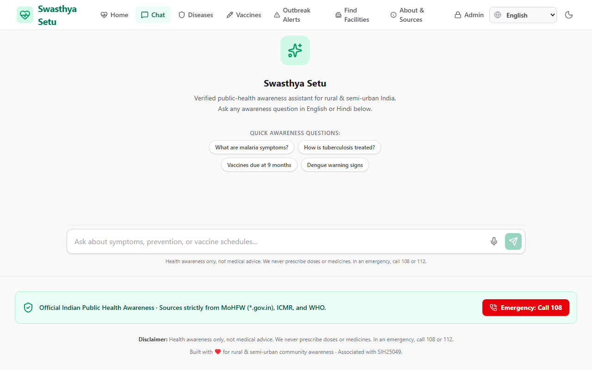
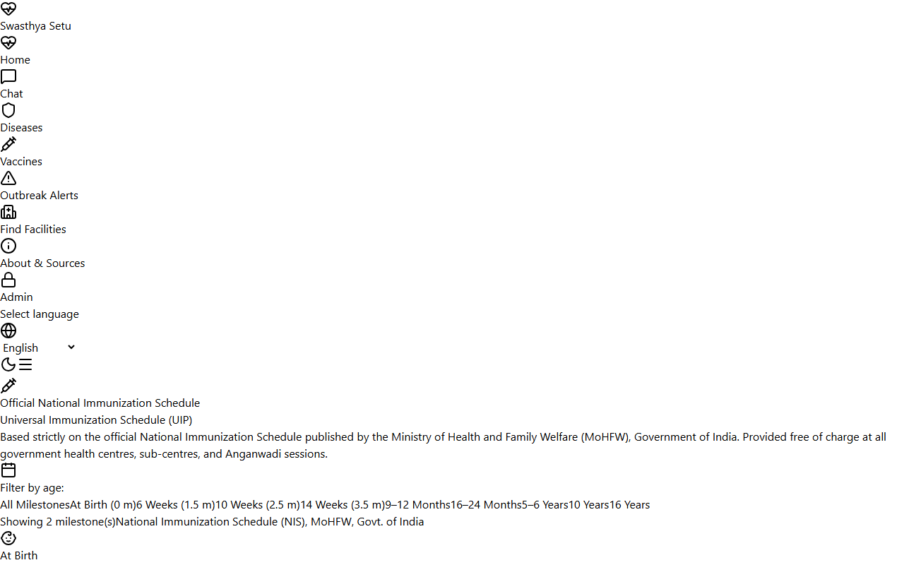
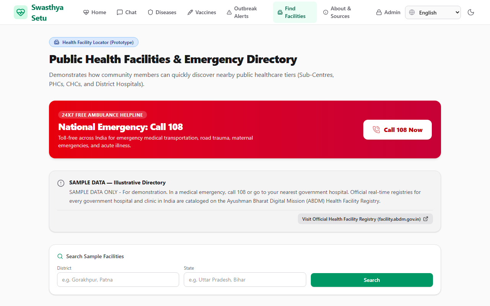
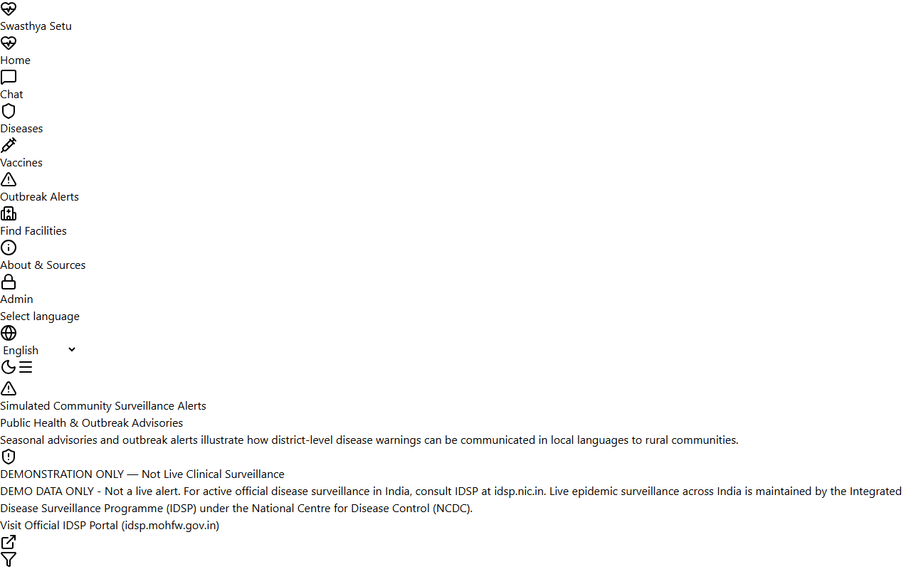

# Swasthya Setu (स्वास्थ्य सेतु)

[](https://github.com/AlapatiAbhinavChowdhary/swasthya-setu/actions/workflows/ci.yml)
[](LICENSE)
[](https://www.python.org/downloads/)
[](https://react.dev/)
[](https://www.typescriptlang.org/)

**Swasthya Setu** is an explainable, awareness-only public health information agent designed for rural and peri-urban communities in India. Built with local multilingual dense embeddings (`intfloat/multilingual-e5-small`), Chroma SQLite vectorstore, BM25 hybrid search, and LangGraph agentic reasoning, Swasthya Setu strictly grounds every medical fact in official Indian government and World Health Organization (WHO) publications.

> [!IMPORTANT]
> **Strict Clinical Guardrails**: Swasthya Setu is an educational awareness tool, **not a diagnostic or prescription system**. It enforces deterministic emergency triage (0 LLM calls, directing immediately to 108), strictly refuses drug doses and personal diagnoses, and verifies all citations against retrieved official passages.

---

## Visual Preview

| Grounded Chat & Citation Inspector | National Immunization Schedule |
|---|---|
|  |  |

| Health Facility & Helpline Directory | Outbreak Advisories & Alerts |
|---|---|
|  |  |

---

## Key Features

1. **Authoritative-Only Sourcing**: 30 high-priority public health conditions indexed strictly from `*.gov.in`, `*.nic.in`, and `who.int`. Ingestion is cryptographically locked with SHA-256 digests in `data/sources.lock.json`.
2. **Dual-Layer Deterministic Safety**:
   - **Emergency Red-Flag Filter**: Detects acute medical emergencies (e.g. vomiting blood, severe chest pain, infant convulsions) in $<0.05\text{s}$ with 0 LLM calls, immediately routing to the 108 ambulance service.
   - **Prescription & Dose Refusal**: Automatically blocks personal prescription requests and scrubs numeric doses (`\b\d+\s*mg\b`) using post-generation regex filters.
3. **Bilingual Grounded Generation**: Standard Hindi (हिन्दी) and English support with Devanagari script normalizers preventing corrupted sub-word tokens.
4. **Verifiable In-Text Citations**: Every claim features interactive citation chips `[N]` mapped to retrieved source documents with authority, title, and page numbers.
5. **Single-Server Web Architecture**: FastAPI backend and built React 18 frontend can be run together from a single command without CORS or reverse proxy configuration.

---

## Quickstart & Local Setup (PowerShell)

### Prerequisites
- Python 3.12+ with [`uv`](https://github.com/astral-sh/uv)
- Node.js 20+ with `npm`
- Google Gemini API Key (`GEMINI_API_KEY`)

### 1. One-Command Full Stack Demo
To launch both the FastAPI backend and the built React Single-Page Application together on port 8000:

```powershell
# Set environment and start single-server distribution
$env:ENABLE_FRONTEND="true"
uv run uvicorn swasthya_setu.api.app:app --host 0.0.0.0 --port 8000
```
Open **[http://localhost:8000](http://localhost:8000)** in your browser.

### 2. Standard Development Setup

```powershell
# 1. Install Python dependencies
uv sync

# 2. Configure environment
Copy-Item .env.example .env
# Edit .env and set GEMINI_API_KEY and GEMINI_MODEL (e.g. gemini-2.5-flash)

# 3. Build vector index from authoritative sources
uv run python scripts/build_index.py

# 4. Ask a question via the CLI
uv run python scripts/ask.py "What are the warning signs of severe dengue?"

# 5. Run the full unit & safety test suite (<6 seconds)
uv run pytest -v

# 6. Run frontend in development mode (optional separate UI dev server)
npm --prefix web install
npm --prefix web run dev
```

---

## System Architecture

```
[ User Input (Web SPA / Mobile / Telegram) ]
                      │
                      ▼
[ Deterministic Triage Layer (0 LLM Calls) ]
  ├─ Emergency Detection (is_emergency -> 108 Card)
  └─ Prescription Refusal (is_prescription -> Doctor Referral)
                      │
                      ▼
[ LangGraph Agent Pipeline ]
  ├─ Intent Router & Query Rewriting (Gemini 2.5 Flash)
  └─ Branching: Out-of-Scope Refusal vs. RAG Pipeline
                      │
                      ▼
[ Retrieval & Ranking Pipeline ]
  ├─ Query Prefixing ("query: ...")
  ├─ Chroma Vectorstore (SQLite + intfloat/multilingual-e5-small)
  └─ Hybrid Search (Dense Cosine Similarity + BM25 Reciprocal Rank Fusion)
                      │
                      ▼
[ Generation & Safety Verification Layer ]
  ├─ Constrained Generation with Numbered Bracket Citations [N]
  ├─ Post-Gen Citation Integrity Check (verify_citations)
  ├─ Regex Dose & Prescription Filter (filter_dose_patterns)
  └─ Mandatory Awareness Disclaimer & 108 Helpline
                      │
                      ▼
[ Server-Sent Events (SSE) Streaming Output ]
```

For complete technical documentation, see [docs/ARCHITECTURE.md](docs/ARCHITECTURE.md).

---

## Official Data Sources

All indexed documents are strictly derived from official public health authorities:

| Authority | Domain / Program | Topics Covered | Integrity Verification |
|---|---|---|---|
| **Ministry of Health and Family Welfare (MoHFW)** | `mohfw.gov.in` | National Immunization Schedule, Maternal Health, Anaemia Mukt Bharat | SHA-256 Lockfile (`data/sources.lock.json`) |
| **National Center for Vector Borne Diseases Control (NCVBDC)** | `ncvbdc.mohfw.gov.in` | Malaria, Dengue, Chikungunya, Kala-Azar, Lymphatic Filariasis, Japanese Encephalitis | SHA-256 Lockfile |
| **National Health Mission (NHM)** | `nhm.gov.in` | Primary Health Centre guidelines, ASHA training manuals, Child health | SHA-256 Lockfile |
| **Indian Council of Medical Research (ICMR)** | `icmr.gov.in` | Standard Treatment Workflows (STWs) for Diabetes, Hypertension, Stroke | SHA-256 Lockfile |
| **World Health Organization (WHO)** | `who.int` | International clinical fact sheets across communicable and non-communicable diseases | SHA-256 Lockfile |

---

## Safety, Privacy & Ethical Posture

- **Privacy by Design**: No personal health information (PHI) is required or stored. Sessions use ephemeral random UUIDs. Admin feedback stores only anonymized ratings and hashes.
- **Offline Capable**: The Chroma vectorstore runs entirely in-process on SQLite without external network calls.
- **Zero Hallucination Policy**: If retrieved passages do not contain verified evidence for an inquiry, the agent issues a safe refusal directing the user to a doctor or local ASHA worker.
- **Deterministic Disclaimers**: Every response carries:
  > *"This is health awareness information, not medical advice. In an emergency, go to the nearest hospital or call 108."*

For detailed safety policies, see [docs/SAFETY.md](docs/SAFETY.md) and [docs/SECURITY.md](docs/SECURITY.md).

---

## Project Documentation Index

- **[docs/ARCHITECTURE.md](docs/ARCHITECTURE.md)**: In-depth technical architecture, embedding engineering, and design decisions.
- **[docs/VIVA_QA.md](docs/VIVA_QA.md)**: 30 viva voce / defense questions and answers for academic presentations.
- **[docs/SIH25049_MAPPING.md](docs/SIH25049_MAPPING.md)**: Smart India Hackathon PS 25049 compliance matrix.
- **[docs/DEMO_SCRIPT.md](docs/DEMO_SCRIPT.md)**: Timed 5-minute presentation script.
- **[docs/EVALUATION.md](docs/EVALUATION.md)**: Comprehensive quota-aware evaluation report across 140 benchmark queries.
- **[docs/RETRIEVAL_EVALUATION.md](docs/RETRIEVAL_EVALUATION.md)**: Hit-Rate@4 retrieval metrics and chunk analysis across 30 diseases.
- **[docs/LIMITATIONS.md](docs/LIMITATIONS.md)**: Transparent boundaries, clinical limitations, and future roadmap.
- **[docs/FINAL_ACCEPTANCE.md](docs/FINAL_ACCEPTANCE.md)**: Verification of all 11 project acceptance criteria.
