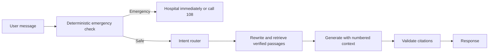

# Safety and grounding

Swasthya Setu provides public-health awareness only. It does not diagnose,
prescribe medicines, or provide doses.

## Request flow

Emergency keywords are checked before any model call, including English, Hindi,
and selected Odia phrases. Generated answers are refused when they contain no
valid citation to retrieved context. Documents are data, not instructions.
Embedding scores are calibrated with `scripts/calibrate_threshold.py`; because
the current in-scope and out-of-scope distributions overlap, retrieved chunks
also pass through a relevance gate before generation.

The emergency response is an urgent signpost, not a diagnosis. Users should
contact a doctor, ASHA worker, or health centre for personal medical advice.
