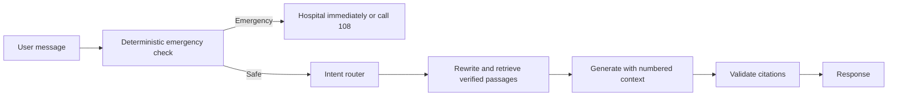

# Safety and grounding

Swasthya Setu provides public-health awareness only. It does not diagnose,
prescribe medicines, or provide doses.

## Request flow

Emergency keywords are checked before any model call, including English, Hindi,
and selected Odia phrases. Generated answers are refused when they contain no
valid citation to retrieved context. Documents are data, not instructions.
Embedding scores are calibrated with `scripts/calibrate_threshold.py`; because
the current in-scope and out-of-scope distributions overlap, retrieved chunks
also pass through a relevance gate before generation.

The emergency response is an urgent signpost, not a diagnosis. Users should
contact a doctor, ASHA worker, or health centre for personal medical advice.

## Medication & Drug Names Policy

1. **Course Duration & Continuity**: Treatment course durations (e.g. "daily for 4 to 6 months") and critical continuity instructions ("do not stop medications early to prevent drug resistance") are permitted when directly supported by retrieved official documents.
2. **Individual Drug Names in Awareness Queries**: Generic drug names (e.g. *rifampicin, isoniazid, pyrazinamide, ethambutol*) may be mentioned **only** in general awareness queries explaining how a disease is treated when they appear explicitly in the official source.
3. **Strict Refusal on Prescription Inquiries**: For any query asking *"what medicine should I take"*, *"what drug to take"*, or *"prescribe medicine"*, the system strictly refuses and redirects to a doctor or ASHA worker without listing any drugs.
4. **Zero Dosage Leakage**: Drug names must **never** be combined with milligram strengths (e.g. 500mg), daily tablet counts (e.g. 2 pills/day), or individualized instructions. All numeric doses are blocked deterministically by `filter_dose_patterns`.

